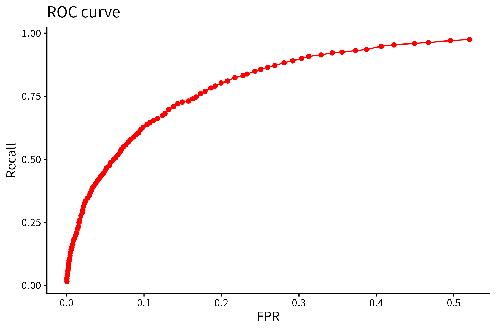
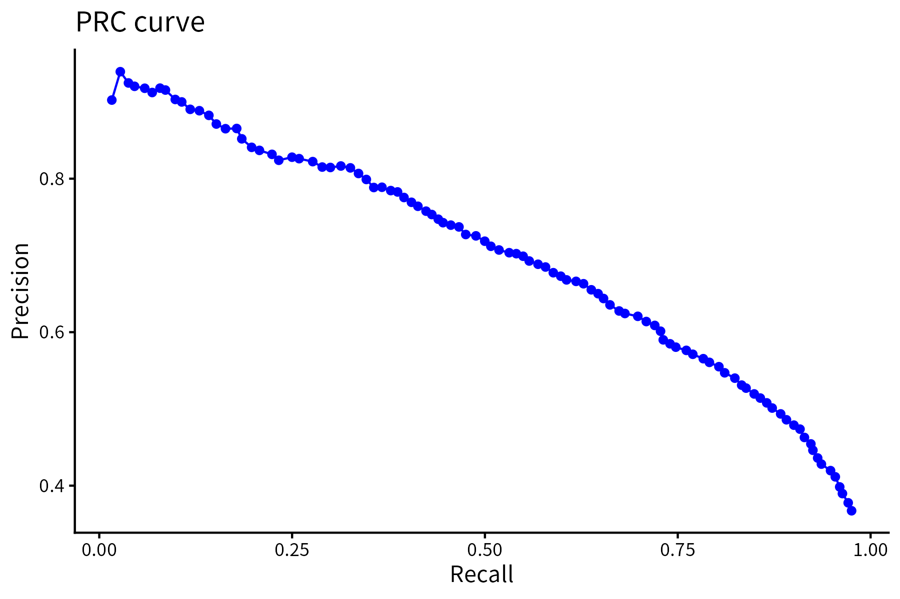

# m6APrediction

This R package predicts possible N6-methyladenosine (m6A) RNA modification sites 
by employing machine learning (ML) models. Its included functions allow to encode 
provided DNA sequences, predict using large tables with samples, and predict 
probabilities of having m6A sites even in single sequences.

## Installation

You can install the current `m6APrediction` version directly from GitHub by using 
the `devtools` or `remotes` package listed below:

```R
# If you don't have devtools installed:
# install.packages("devtools")

# Install the package from GitHub
devtools::install_github("edainbeln26/m6APrediction")
```

## Model Performance Metrics

The current model presents a high capcity to predict and identify m6A sites as
showed in below by a Receiver Operating Characteristic (ROC) and a Precision-Recall 
(PRC) curve obtained during the model training process:



